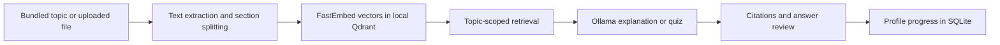

# LearnPulse

**A local study workspace that turns course notes into cited explanations and practice.**

Choose a bundled computer science topic or upload a text-based PDF, TXT, or Markdown file. LearnPulse retrieves relevant passages, asks an Ollama model to explain or quiz you on them, and keeps your progress on your own computer.

| Library | Study | Practice | Progress |
| --- | --- | --- | --- |
| Browse course topics and manage personal files. | Generate an explanation beside its source excerpts. | Answer three source-linked questions and review the grading. | See mastery by topic and recent attempts. |

## Run on Windows

You need Python 3.10+, Node.js 18+, npm, and [Ollama](https://ollama.com/download). The default model is `qwen3:4b-instruct-2507-q4_K_M`. Ollama must be running locally.

```powershell
git clone https://github.com/ss-sevesh/learnpulse.git
cd learnpulse
python -m venv .venv
.\.venv\Scripts\python.exe -m pip install -r requirements.txt
cd frontend
npm ci
cd ..
ollama pull qwen3:4b-instruct-2507-q4_K_M
.\.venv\Scripts\python.exe run.py
```

Open **http://localhost:5173**. The API documentation is at **http://127.0.0.1:8000/docs**. The first startup downloads the embedding model and builds the local search index, so it takes longer than later launches. To use another installed model, set `OLLAMA_MODEL`; to use another Ollama endpoint, set `OLLAMA_URL`.

## How it works



The four tabs follow that flow:

| Tab | Learner action | Technical flow |
| --- | --- | --- |
| Library | Select a bundled topic, upload notes, or delete an upload. | Extract text, split it into sections, embed with FastEmbed, and index the sections in local Qdrant under the selected profile. PDF excerpts retain page numbers. |
| Study | Generate a topic explanation and inspect its sources. | Retrieve only that topic's sections, send them to Ollama, validate structured output, and show the matching excerpts. |
| Practice | Generate and submit three multiple-choice questions. | Ollama creates source-linked questions. The server stores the answer key, grades one submission per quiz, and updates difficulty and mastery. |
| Progress | Review mastery and attempts. | Read the selected profile's persisted quiz history and mastery values. |

The five bundled profiles contain **synthetic sample data**. New local profiles start empty. Profiles have no authentication and are intended for a trusted single-computer setup. Uploaded material belongs to the selected profile, but anyone with access to this local app can switch profiles.

Files are limited to 10 MB and 300 indexed sections; PDFs to 50 pages. Image-only PDFs have no extractable text and need OCR before upload. AI output can be wrong even when it references a source, so review cited excerpts when using explanations or grading answers.

## Local storage and verification

- Profiles, materials, quiz records: `data/learnpulse.sqlite3`
- Original uploads: `data/uploads/`
- Search index: `data/qdrant_db/`
- Bundled curriculum: `data/syllabus/`

The bundled curriculum and synthetic profile JSON are retained. The app copies sample profiles into SQLite on first run and does not modify the source JSON. The local database, original uploads, and search index are excluded from Git.

```powershell
.\.venv\Scripts\python.exe -m pytest tests -q
cd frontend
npm run lint
npm run build
```

The interface and implementation decisions are in [the design notes](design.md), [specification](SPEC.md), and [task breakdown](tasks/plan.md).
